<p align="center">
  
</p>

<p align="center">
  
  
  
  
  
</p>

<h3 align="center">

```
root@oxa:~# ./boot_sequence.sh --day=01 --operator=A-straya
```

</h3>

<p align="center"><i>A virgin server. An empty canvas. A company that doesn't exist yet.<br>
By the end of today, it breathes. By Day 03, it bleeds.</i></p>

<br>

```diff
+ [BOOT]   OXA-DC01 ................................ ONLINE
+ [BOOT]   WIN10-CLIENT ............................ ONLINE
+ [BOOT]   KALI-ATK01 .............................. STANDBY — Day 03
! [ALERT]  Hardening status: NONE (intentional — see day02)
! [ALERT]  Attack surface:  GROWING
+ [AUTH]   Operator A-straya ....................... VERIFIED
```

---

## `0x00` — Briefing

**Company OXA** doesn't exist. We're building it from nothing: one blank Windows Server,
one blank Windows 10 client, and an empty GNS3 canvas. By the time Day 01 closes, it's a real
domain with real services and real traffic moving across the wire — a living target with
a pulse, ready to be hunted on Day 03.

| | |
|---|---|
|  **Build target** | Company OXA — `oxa.local` |
|  **Operator** | `A-straya` |
|  **Nodes** | Windows Server (DC) · Windows 10 (client) · Kali (standby) |
|  **Platform** | GNS3 + VMware Workstation |
|  **Day 01 goal** | AD DS, DNS, DHCP, file share, IIS, FTP — all live, all joined |
|  **Next** | Day 02 rips the hardening off on purpose |

---

## `0x01` — Live Topology

<p align="center">
  
</p>

<p align="center"><sub>🟢 green pulse = AD / DNS / DHCP traffic &nbsp;·&nbsp; 🔵 blue pulse = client requests &nbsp;·&nbsp; 🔴 red = Kali, standing by for Day 03</sub></p>

<p align="center">
  <a href="https://A-straya.github.io/oxa-pentesting-hardening/topology/oxa_topology.html">
    
  </a>
</p>

> ⚠️ Isolated lab network only. Never bridge this to a real LAN — it's going to be
> *deliberately* vulnerable by Day 02.

---

## `0x02` — Build Log

> Tick these off as you go. Full step-by-step is in `docs/OXA_Day1_Guide.pdf`.

### GNS3 + hypervisor
- [ ] GNS3 installed, VMware Workstation installed, `vmrun` resolvable from PATH
- [ ] Three VM templates imported: `OXA-DC01`, `WIN10-CLIENT`, `KALI-ATK01`
- [ ] Topology wired: Switch ↔ Server, Switch ↔ Client (Kali attached, powered off)

### `OXA-DC01` — Windows Server
- [ ] Hostname set → `OXA-DC01`
- [ ] Static IP → `192.168.10.10 /24`, DNS → `127.0.0.1`
- [ ] AD DS role installed → forest `oxa.local` created → server promoted
- [ ] OUs created: `Employees`, `IT`, `Servers`
- [ ] Users created: `j.martin` (standard), `s.admin` (Domain Admins)
- [ ] Group created: `GRP-Finance`
- [ ] DHCP role installed → scope `192.168.10.100–200` → activated
- [ ] SMB share live → `\\OXA-DC01\Finance`
- [ ] IIS installed → default site reachable at `http://192.168.10.10`
- [ ] FTP site created (no SSL — intentional)
- [ ] 📸 Snapshot taken: `00-clean-install`

### `WIN10-CLIENT` — Windows 10
- [ ] DNS points at `192.168.10.10` (static or via DHCP)
- [ ] Joined domain `oxa.local`
- [ ] Logged in as `OXA\j.martin` successfully
- [ ] Computer object visible in ADUC on the DC

---

## `0x03` — Verification

```powershell
# On OXA-DC01
Get-ADDomain
Get-Service DNS, NTDS, Netlogon, DHCPServer

# On WIN10-CLIENT
Get-ComputerInfo | Select CsDomain
```

```diff
+ [OK]  oxa.local .............................. resolvable
+ [OK]  \\OXA-DC01\Finance ..................... reachable
+ [OK]  http://192.168.10.10 ................... 200 OK
+ [OK]  WIN10-CLIENT joined to OXA ............. confirmed
```

---

## `0x04` — Roadmap

| Day | Codename | What happens |
|:---:|---|---|
| **01** | `BUILD` | ✅ Stand up OXA: AD, DNS, DHCP, IIS, SMB, FTP, domain-joined client |
| 02 | `HARDEN⁻¹` | Strip patches, loosen Defender/firewall, plant weak creds + SMBv1, snapshot the vulnerable state |
| 03 | `BREACH` | Kali recon (Nmap) → vuln scan → Metasploit exploitation → lateral movement → write-up |

---

<details>
<summary><b>⚙ Hosting the live topology yourself (GitHub Pages)</b></summary>

<br>

`oxa_topology.html` is a single self-contained file — no server, no dependencies, nothing tied to any external service.

1. Put the file at `topology/oxa_topology.html` in this repo.
2. Repo → **Settings** → **Pages** → Source: **Deploy from a branch** → branch `main`, folder `/ (root)` → Save.
3. GitHub will serve it at `https://A-straya.github.io/oxa-pentesting-hardening/topology/oxa_topology.html` — matches the badge above.
4. Or skip Pages entirely — just open the file locally, it works fully offline in any browser.

</details>

<p align="center">
<sub>🟢🔵🔴 Internal lab repo · Company OXA is a fictional pentest/hardening training target · Not a real organization<br>
Maintained by <b>A-straya</b></sub>
</p>

